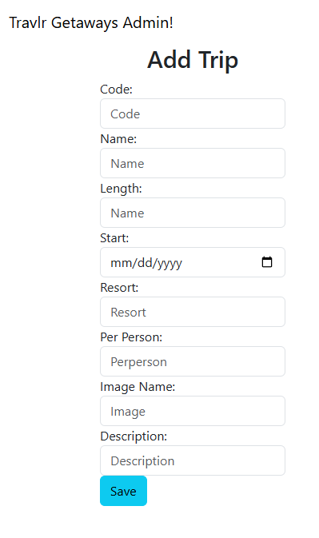
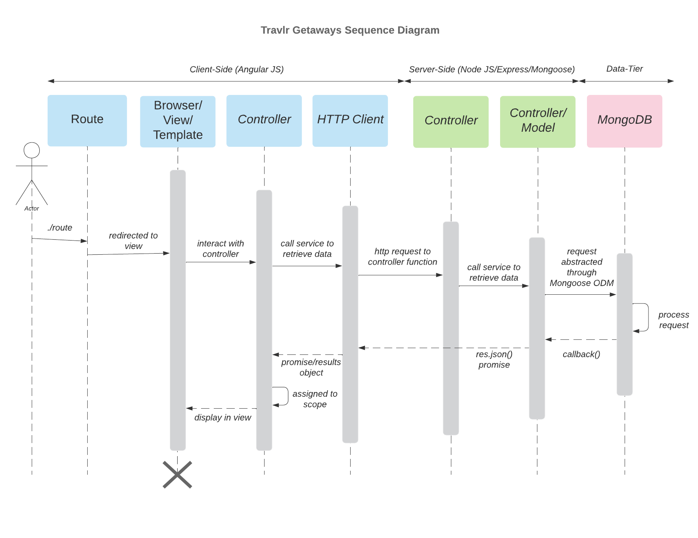

## Technical Skills
* **Languages:** Java, C#, C++, Python
* **Tools and Frameworks:** Git, Github Actions, Maven, Node.js, Angular, Express, JUnit, MAUI, .Net 
* **Concepts:** OOP, Data Structures and Algorithms, Security and Testing, CI/CD, Architectural Designs

---

## Projects and Applications

### Appointment Book
* Explaination
* further
* further

### Full Stack Travel Webpage
* Developed a full-stack travel application featuring a public-facing website and an administrative dashboard for managing travel listings. Built a Node.js and Express backend with a MongoDB database to store and retrieve application data through RESTful API endpoints. Implemented an Angular single-page application (SPA) with functionality to view, add, and edit travel listings, user registrations, login credentials, and authentication.
  
* Technologies: Javascript, Node.js, Express.js, Angular, MongoDB, Mongoose, REST APIs, Handlebars, Bootstrap, Git/GitHub.
  
* Insert WebPage

    
    

---

## Education
* **B.S. in Computer Science (Software Engineering) - SNHU 2026**
* **A.A.S in Physical Therapist Assistant - Blinn College 2019**
* **B.S. in Kinesiology - Texas A&M 2013**

## Professional Experience
* 7 Years in hospital and rehabilitation settings as a licensed Physical Therapist Assistant
