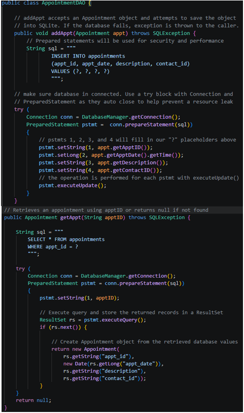
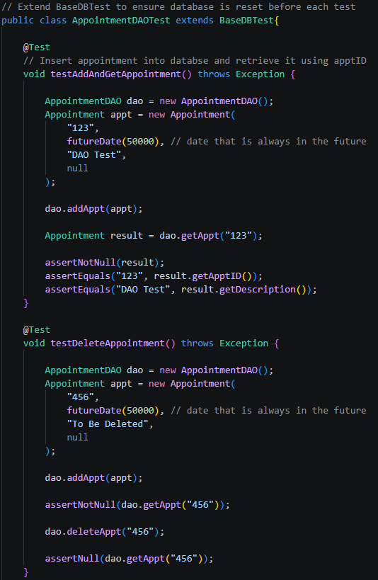
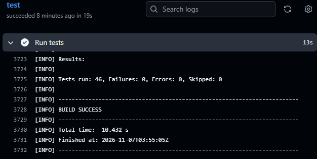
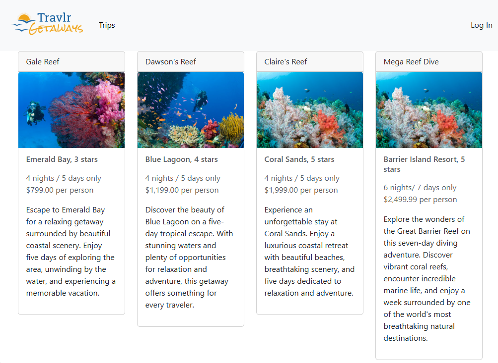

## Technical Skills
* **Languages:** Java, C#, C++, Python, JavaScript
* **Tools and Frameworks:** Git, GitHub Actions, Maven, Node.js, Angular, Express, JUnit 5, .NET MAUI,
* **Concepts:** OOP, Data Structures and Algorithms, SQL, REST APIs, Testing, CI/CD, Software Architecture

---

## Projects and Applications

### Appointment Book
* Upgraded a Java-based appointment management application to use persistent SQLite database storage instead of temporary in-memory data structures. Implemented a layered architecture separating data models, database operations, and business logic. Expanded automated testing and configured GitHub Actions to run tests as part of a continuous integration workflow.

* Technologies & Tools: Java, SQLite, JDBC, Maven, JUnit 5, Git/GitHub, GitHub Actions.
  
* Implemented JDBC-based database operations using parameterized SQL queries to insert and retrieve appointment records. Used prepared statements and automatic resource management to interact with the SQLite database safely and reliably.

  
  
<em>AppointmentDAO — SQLite Database Operations</em>

 
  * JUnit 5 tests verifying appointment creation, retrieval, deletion, and updates. Tests interact with the SQLite database and use assertions to confirm that database operations produce the expected results.
 

  
  
<em>AppointmentDAO - Database Integration Testing</em>

 
  * Configured a GitHub Actions CI workflow to automatically build and execute the Maven/JUnit test suite on each push. All 46 tests pass, verifying application functionality and database operations.
    

  
  
<em>GitHub Actions CI Workflow</em>

### Full Stack Travel Webpage
* Enhanced a full-stack travel application featuring a public-facing website and an administrative dashboard. Worked with an Angular frontend and a Node.js/Express backend connected to MongoDB through Mongoose. Implemented and refined REST API functionality for retrieving and managing travel listings, along with administrative authentication and access.
  
* Technologies & Tools: JavaScript, Node.js, Express.js, Angular, MongoDB, Mongoose, REST APIs, Handlebars, Bootstrap, Git/GitHub.

<table style="width:100%; table-layout:fixed; border:none;">
<tr>
<td style="width:35%; text-align:center; vertical-align:middle; border:none;">

</td>
<td style="width:65%; text-align:center; vertical-align:middle; border:none;">

</td>
</tr>
</table>

---

## Education
* B.S. in Computer Science (Software Engineering) - SNHU 2026
* A.A.S in Physical Therapist Assistant - Blinn College 2019
* B.S. in Kinesiology - Texas A&M 2013

## Professional Experience
* 7 Years in hospital and rehabilitation settings as a licensed Physical Therapist Assistant
* History of professional experience working on teams with client centered goals
